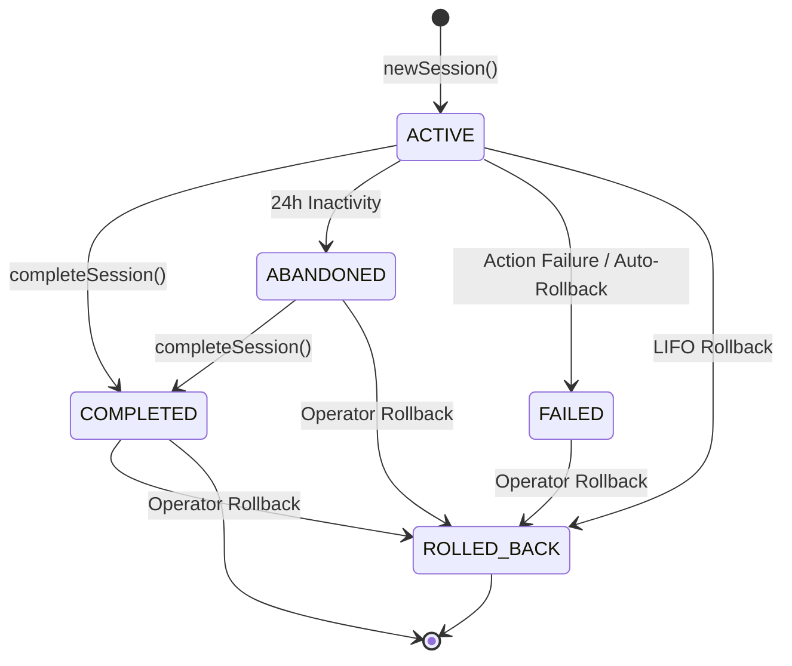

AgentRein provides zero-friction reliability for AI agents by acting as an invisible proxy and execution safety net. This page explains the key concepts and mechanisms that power AgentRein.

<Columns cols={3}>
  <Card title="Transparent Proxy" icon="shuffle">
    Intercepts SDK method calls at any depth while fully preserving original TypeScript types and Python client interfaces.
  </Card>

  <Card title="LIFO Rollback Engine" icon="rotate-left">
    Reverses multi-step production side-effects in strict Last-In-First-Out order when errors or rejections occur.
  </Card>

  <Card title="Human-in-the-Loop" icon="user-check">
    Pauses or reviews sensitive actions to wait for human reviewer sign-off via dashboard or API.
  </Card>
</Columns>

---

## 1. The Transparent Recursive Proxy (`wrap()`)

At the core of AgentRein is the `wrap()` method. Instead of forcing developers to adopt custom client wrappers or new syntax, `wrap()` uses a JavaScript/Python proxy to intercept calls on existing SDK objects.

When you call `agentrein.wrap(client, session, { connector })`:

1. **Deep Nesting Support**: Intercepts method calls regardless of property depth (e.g., `octokit.rest.issues.create` or `stripe.subscriptions.cancel`).
2. **Operation Classification**: Automatically maps target method names (`create`, `update`, `delete`, `del`, `post`) into standardized backend operations (`CREATE`, `UPDATE`, `DELETE`).
3. **Payload & Response Capture**: Logs input arguments and execution responses to the backend action registry.
4. **Type Safety**: Preserves 100% of native TypeScript type signatures and IDE autocompletion.

<CodeGroup>
```typescript TypeScript
const agentStripe = agentrein.wrap(stripeClient, session, {
  connector: 'stripe',
});

// Calling wrapped methods executes normally while logging side-effects
const customer = await agentStripe.customers.create({
  email: 'user@example.com',
});
```

```python Python
agent_stripe = agentrein.wrap(stripe_client, session, connector="stripe")

# Calling wrapped methods executes normally while logging side-effects
customer = agent_stripe.customers.create(
    email="user@example.com",
)
```
</CodeGroup>

---

## 2. Session Lifecycle & State Machine

Every agent execution run is encapsulated within a **Session**. A Session groups related tool actions, tracks overall intent, and maintains execution state.



<Note>
  **Action vs. Session Status**: Individual actions carry an `ActionStatus` such as `PENDING_APPROVAL` or `CLEARED` while waiting for human review or execution confirmation, during which the parent Session remains `ACTIVE`. If a before-execution approval is rejected or expires, the action becomes `FAILED` and a session rollback is triggered. If an after-execution approval is rejected by a reviewer, the action stays `SUCCESS` and only that single action is rolled back; the session is not rolled back as a whole (if it expires, nothing is rolled back). If a rollback approval is rejected or expires, the action stays `SUCCESS` with its undo marked `DECLINED`; no rollback.
</Note>

### Stored vs Derived Session States

The database stores raw session status (`ACTIVE`, `COMPLETED`, `FAILED`, `ROLLED_BACK`, `ABANDONED`). When querying sessions via API, the backend computes a dynamic `displayStatus`:

| Display Status | Plain-Language Meaning |
| :--- | :--- |
| `ACTIVE` | Session is live and executing actions. |
| `COMPLETED` | Session completed cleanly via `completeSession()`. |
| `ABANDONED` | Session experienced 24 hours of inactivity without completion. |
| `AWAITING_APPROVAL` | Session has actions currently pending reviewer approval. |
| `ROLLING_BACK` | Session is actively undergoing undo compensation (`IN_PROGRESS`). |
| `REVERTED` | All executed actions have been completely rolled back (`ROLLED_BACK`). |
| `PARTIALLY_REVERTED` | Some actions were rolled back while others remain successful. |
| `ROLLBACK_FAILED` | An action failed during the rollback process. Operators can retry it; see [Statuses](/statuses). |

<CodeGroup>
```typescript TypeScript
// Start session
const session = await agentrein.newSession({
  agentId: 'billing-agent',
  intent: 'Process monthly invoice batch',
});

// Complete session on success
await agentrein.completeSession(session);

// Or trigger explicit manual rollback if needed
await agentrein.rollbackSession(session);
```

```python Python
# Start session
session = agentrein.new_session(
    agent_id="billing-agent",
    intent="Process monthly invoice batch",
)

# Complete session on success
agentrein.complete_session(session)

# Or trigger explicit manual rollback if needed
agentrein.rollback_session(session)
```
</CodeGroup>

---

## 3. Automatic LIFO Rollback Engine

When an agent executes multi-step workflows across external services, an unexpected failure midway can leave production systems in an inconsistent state.

AgentRein solves this by recording every state-modifying action in the backend **Rollback Registry**.

### How LIFO Rollback Works

1. **Side-Effect Tracking**: Each successful action captures inverse metadata (or an `undoConfig` strategy such as `http-delete` or connector-specific inverse calls).
2. **Reverse Execution Order**: When a session rollback runs (see triggers below), AgentRein executes inverse compensation actions in strict **Last-In-First-Out (LIFO)** order (e.g., Step 3 $\rightarrow$ Step 2 $\rightarrow$ Step 1).
3. **Automatic Triggering**: Rollback triggers automatically when:
   - An unhandled exception occurs in wrapped SDK calls or action logging fails.
   - A before-execution approval request is rejected or expires.
   - An approval gate is unavailable on your plan.
   - An action is reported as failed.
   - You call `agentrein.rollbackSession(session)`.

<Note>
  Actions marked with an `undoConfig` type of `none` (such as immutable notifications) are logged for auditing but skipped during rollback execution.
</Note>

---

## 4. Human-in-the-Loop (HITL) & Approval Gates

For sensitive operations—such as canceling subscriptions, deleting databases, or deploying code—you can require explicit human approval.

### Pre-Execution vs Post-Execution Approvals

- **Before-Execution Approval**: Explicitly requested in the SDK via `wrap({ requiresApproval: ['subscriptions.cancel'] })`. The SDK pauses local execution, logs the action as `PENDING_APPROVAL`, and polls `GET /approvals/:id`. When approved, action becomes `CLEARED`, the SDK executes the call locally, and confirms success via `PATCH`.
- **After-Execution Approval**: Created when a standard logged action matches an organization policy with `REQUIRE_APPROVAL`. The action executed locally, but the backend flags it for after-execution reviewer review. If rejected by a reviewer, single-action rollback is triggered.

<CodeGroup>
```typescript TypeScript
import { AgentRein, ApprovalRejectedError, ApprovalTimeoutError } from 'agentrein';

const agentStripe = agentrein.wrap(stripeClient, session, {
  connector: 'stripe',
  requiresApproval: ['subscriptions.cancel', 'customers.del'],
  pollIntervalMs: 2000, // Poll every 2 seconds
  timeoutMs: 300000,    // Wait up to 5 minutes
});

try {
  // Pauses execution and polls backend until approved/rejected
  await agentStripe.subscriptions.cancel({ id: 'sub_999' });
  console.log('Action approved and executed!');
} catch (err) {
  if (err instanceof ApprovalRejectedError) {
    console.error(`Approval rejected by reviewer: ${err.reason}`);
    // Session actions have already been automatically rolled back!
  } else if (err instanceof ApprovalTimeoutError) {
    console.error('Approval request timed out');
  }
}
```

```python Python
from agentrein import AgentRein, ApprovalRejectedError, ApprovalTimeoutError

agent_stripe = agentrein.wrap(
    stripe_client, session,
    connector="stripe",
    requires_approval=["subscriptions.cancel", "customers.delete"],
    poll_interval_ms=2000,
    timeout_ms=300000,
)

try:
    # Pauses execution and polls backend until approved/rejected
    agent_stripe.subscriptions.cancel(id="sub_999")
    print("Action approved and executed!")
except ApprovalRejectedError as err:
    print(f"Approval rejected by reviewer: {err.reason}")
    # Session actions have already been automatically rolled back!
except ApprovalTimeoutError as err:
    print("Approval request timed out")
```
</CodeGroup>

---

## 5. Organization Policy Engine

Centralize governance rules across all agent teams using AgentRein's **Policy Engine**. Managed via the Dashboard REST API, policies enforce runtime rules across logged actions.

### Policy Actions

| Action Type | Behavior |
| :--- | :--- |
| `ALLOW` | Permits the action to proceed normally. |
| `REQUIRE_APPROVAL` | For standard logged actions, records an after-execution approval request. If rejected, triggers single-action rollback. |
| `BLOCK` | For standard logged calls, records the action as `FAILED` upon logging and returns HTTP `403` with error type `policy-blocked`. |

<Warning>
  **Server Enforcement Scope**: Server-side policy results are recorded and enforced as far as the SDK cooperates. An agent that bypasses the AgentRein SDK and invokes external APIs directly is not blocked by the server. AgentRein does not expose a pre-execution authorize endpoint.
</Warning>

### Policy Conflict Resolution

When multiple enabled policies match an action, AgentRein evaluates them in order of strictness:
$$\text{BLOCK} > \text{REQUIRE\_APPROVAL} > \text{ALLOW}$$

---

## 6. Intent Verification & Drift Detection

AgentRein continuously evaluates whether agent actions align with their declared session goals.

### Outcome Statuses

When a session specifies an `intent`, AgentRein's LLM engine evaluates actual execution results against that intent:

- **`VERIFIED`**: The action outcome directly aligns with the stated intent.
- **`DRIFT_DETECTED`**: Outcome shows significant divergence from the intent.
- **`UNVERIFIED`**: Verification infrastructure issue prevented evaluation.

---

## 7. Resilience, Retry & Sandbox Engine

### Failure Modes (`open` vs `closed`)

AgentRein allows you to configure client behavior if the AgentRein backend service becomes unreachable:

- `failureMode: 'open'` *(Default)*: Logs warning messages to standard output and permits tool execution to proceed without safety guarantees.
- `failureMode: 'closed'`: Strictly throws `AgentReinUnavailableError` and halts agent execution to prevent non-monitored actions.

### Automated Transient Retry

Specify transiently retryable method paths using the `retryable` parameter:

```typescript
const agentGithub = agentrein.wrap(octokit, session, {
  connector: 'github',
  retryable: ['issues.create', 'pulls.create'],
});
```

AgentRein automatically retries transient network errors using exponential backoff while embedding unique idempotency tokens into outgoing requests.